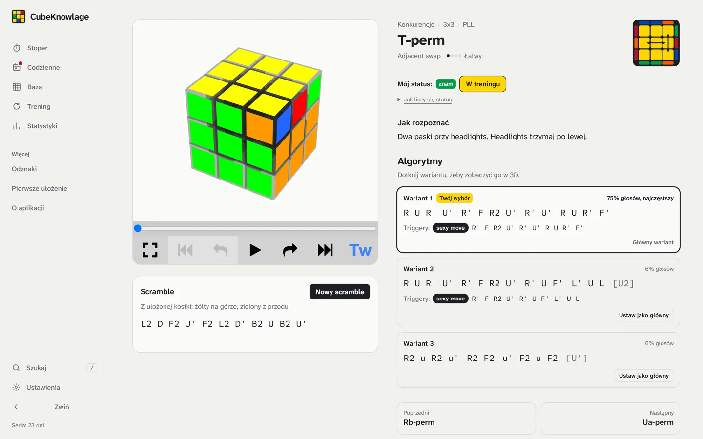
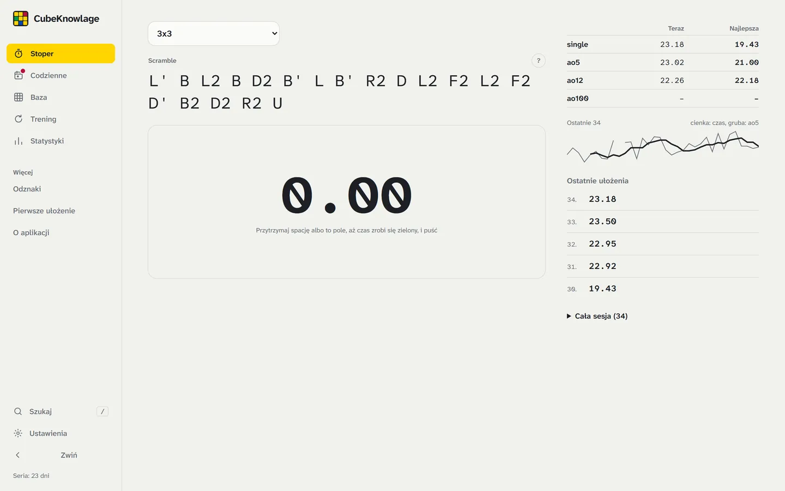
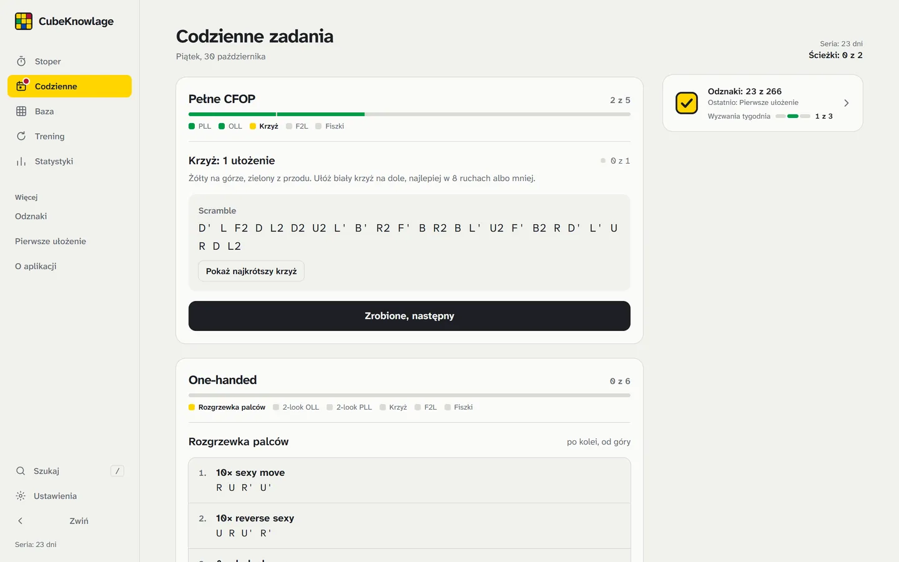
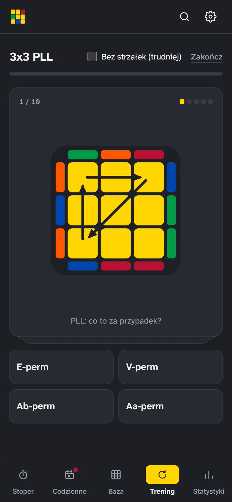
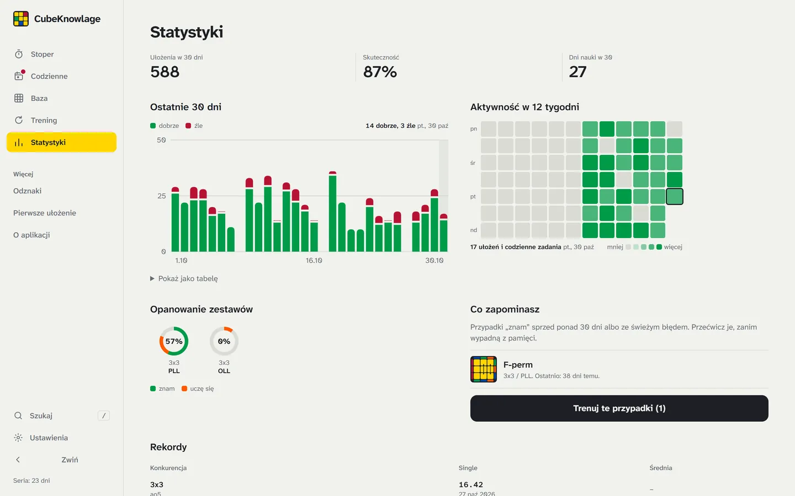

# CubeKnowlage

**Nie pamiętasz algorytmu? Znajdziesz go w kilka sekund.**

Darmowa aplikacja po polsku dla cuberów: stoper, baza algorytmów i codzienny plan nauki w jednym miejscu, od pierwszego ułożenia kostki Rubika do sub-20 w CFOP.

### [Otwórz aplikację: cubeknowlage.com](https://cubeknowlage.com)

Za darmo · bez konta · działa w przeglądarce na telefonie i komputerze, także offline

[English below](#english)

## Dla kogo

| Jeśli… | CubeKnowlage daje Ci |
|---|---|
| **nie umiesz jeszcze układać kostki** | prowadzenie ruch po ruchu z animacją i metodę warstwową w 8 krokach (7 algorytmów, ok. godziny) |
| **układasz warstwami i chcesz szybciej** | 2-look OLL i PLL (16 algorytmów), intuicyjne F2L i plan na kilka minut dziennie |
| **znasz CFOP** | 21 PLL, 57 OLL i 41 F2L do przypominania, fiszki z tym, co zapominasz, i poradnik „droga do sub-20” |
| **chcesz ułożyć wszystkie kostki** | metody dla początkujących 12 konkurencji (od 2x2 i Pyraminxa po Square-1, FTO i 7x7) i tryb Guildford Challenge |

## Co potrafi

**Stoper jak csTimer, po polsku.** Scramble WCA dla 12 konkurencji, Clock i 3BLD, inspekcja 15 s, +2 i DNF, ao5, ao12, ao100 i wykres. Ćwiczenie białego krzyża i Cross+1 pokazuje najkrótsze możliwe rozwiązanie.

**Baza algorytmów.** PLL, OLL, F2L, 2-look, One-handed, 2x2 Ortega, parzystości 4x4 i 5x5. Przy każdym przypadku diagram, wskazówka, jak go rozpoznać, zapis triggerami, podział na krótkie fragmenty, animacja 3D i scramble do ćwiczenia. Możesz dodać własny algorytm: aplikacja sprawdzi na modelu kostki, czy rozwiązuje ten przypadek.

**Codzienne zadania.** Trzy pytania i plan na kilka minut dziennie, dopasowany do poziomu: rozgrzewka, przypadki, krzyż, F2L, kolejny krok metody. Do trzech ścieżek naraz, każda w swojej karcie.

**Trening i fiszki.** Trening losuje scramble przypadku, a stoper ocenia: po serii szybkich ułożeń przypadek dostaje status „znam”, a gdy zaczniesz się mylić, wraca do nauki. Fiszki uczą rozpoznawania bez kostki, a mylone karty wracają częściej.

**Statystyki i odznaki.** Co zapominasz, skuteczność dzień po dniu, kalendarz aktywności, rekordy wszystkich konkurencji, 264 odznaki i trzy wyzwania co tydzień.

**Niezapominajka.** Twoja lista algorytmów z diagramami, gotowa do wydruku albo zapisania jako PDF.

## Twoje dane zostają u Ciebie

Nie ma kont. Czasy, odznaki i postęp są zapisane w pamięci przeglądarki na Twoim urządzeniu i nie trafiają na żaden serwer. Na inne urządzenie przeniesiesz je kodem QR, linkiem albo plikiem kopii.

## Na telefonie

Otwórz [cubeknowlage.com](https://cubeknowlage.com) i dodaj stronę do ekranu początkowego (iPhone: „Udostępnij”, potem „Do ekranu początkowego”; Android: „Zainstaluj aplikację”). Działa jak aplikacja, także bez internetu.

## Opinie i błędy

W aplikacji: menu „Więcej” → **„Oceń aplikację”**. Możesz też założyć [Issue w tym repozytorium](../../issues).

---

## English

**CubeKnowlage** is a free speedcubing web app (currently in Polish, English version in progress): a csTimer-style timer with WCA scrambles for 12 events, an algorithm library (PLL, OLL, F2L, 2-look, one-handed, 2x2 Ortega, 4x4/5x5 parity) with diagrams, recognition tips, triggers and 3D animation, spaced-repetition flashcards, daily practice plans, beginner methods for all 12 Guildford Challenge events, stats and badges. No account: everything stays in your browser and can be moved to another device with a QR code. Works offline when added to the home screen.

**[Open the app: cubeknowlage.com](https://cubeknowlage.com)**

---

To repozytorium jest wizytówką aplikacji; kod źródłowy jest prywatny. © CubeKnowlage. Wszelkie prawa zastrzeżone. Algorytmy pochodzą z publicznych źródeł społeczności speedcubingowej (SpeedCubeDB, J Perm, CubeSkills, Speedsolving Wiki), każdy sprawdzony testami na modelu kostki.
